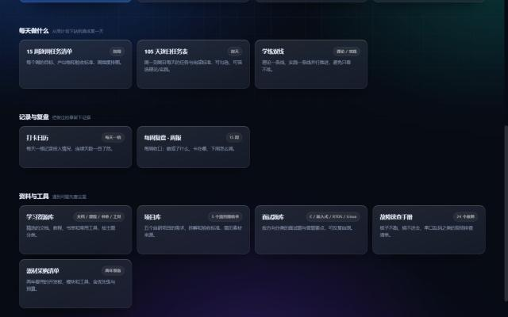

<div align="center">

# 嵌入式学习站 · AI 嵌入式 + 机器人

一套两年期的嵌入式学习系统：从「两年要走到哪」一路拆到「今天做什么」。

[](https://1233big.github.io/stm-project/)
[](LICENSE)
[](https://github.com/1233big/stm-project/actions/workflows/link-check.yml)

</div>



## 这是什么

不是一个「学习清单合集」，而是按时间推进的操作系统，四层结构各管一件事：

| 层 | 页面 | 解决的问题 |
| --- | --- | --- |
| 方向 | 路线图、全栈计划、就业达标路线 | 两年到底走到哪 |
| 执行 | 15 周清单 → 105 天逐日表 → 学练双线 | 这周、今天做什么 |
| 反馈 | 打卡日历、每周复盘 | 做了没有、哪里卡住 |
| 资料 | 资源库、项目库、面试题库、故障速查、器材清单 | 卡住时去哪查 |

纯静态站点，没有后端。勾选进度、打卡记录存在浏览器 `localStorage` 里，换设备不会同步。

## 在线访问

**https://1233big.github.io/stm-project/**

## 页面清单

| 页面 | 文件 | 作用 |
| --- | --- | --- |
| 站点首页 | [`index.html`](index.html) | 全部页面的导航入口 |
| 学习总控台 | [`学习总控台.html`](学习总控台.html) | 进度汇总看板，从这里开始 |
| 成长路线图 | [`AI嵌入式机器人成长路线图.html`](AI嵌入式机器人成长路线图.html) | 两年蓝图，按阶段拆能力与里程碑 |
| 全栈学习计划 | [`嵌入式软硬件全栈学习计划.html`](嵌入式软硬件全栈学习计划.html) | 2026.11 → 2029.06 的四层学习清单 |
| 就业达标补充路线 | [`就业达标补充路线.html`](就业达标补充路线.html) | 从校招要求倒推的补强项 |
| 15 周逐周清单 | [`15周逐周任务清单.html`](15周逐周任务清单.html) | 周维度的目标与产出物 |
| 105 天逐日任务表 | [`105天逐日任务表.html`](105天逐日任务表.html) | 每天的任务与完成标准，`plan-data.js` 的数据源 |
| 学练双线 | [`学练双线.html`](学练双线.html) | 理论线与实践线并行推进 |
| 打卡日历 | [`打卡日历.html`](打卡日历.html) | 每天一格记录投入 |
| 每周复盘 | [`每周复盘-周报.html`](每周复盘-周报.html) | 每周收口与调整 |
| 学习资源库 | [`学习资源库.html`](学习资源库.html) | 文档、课程、书单、工具 |
| 项目库 | [`项目库.html`](项目库.html) | 五个自研项目的规格书 |
| 面试题库 | [`面试题库.html`](面试题库.html) | C / 嵌入式 / RTOS / Linux 题目 |
| 故障速查手册 | [`故障速查手册.html`](故障速查手册.html) | 24 个现场排查清单 |
| 器材采购清单 | [`器材采购清单.html`](器材采购清单.html) | 两年装备、优先级与预算 |

## 本地运行

页面依赖相对路径，直接双击打开也能看，但用本地服务器更接近线上环境：

```bash
python -m http.server 8130 --bind 127.0.0.1
```

然后打开 <http://127.0.0.1:8130/>。

## 目录结构

```
.
├── index.html                站点首页（GitHub Pages 入口）
├── *.html                    14 个内容页面
├── favicon.ico               站点图标
├── assets/
│   ├── theme.css             设计系统：暗色 · 液态玻璃 · 全宽布局
│   ├── theme-light.css       浅色版存档，回退时替换 theme.css
│   ├── plan-data.js          由逐日任务表自动生成，勿手改
│   ├── pointer.js            指针光效
│   └── reveal.js             滚动入场动画
├── scripts/
│   ├── build-plan-data.js    从逐日表提取数据，生成 plan-data.js
│   └── check-links.js        站内链接检查
├── docs/preview.jpg          页面预览图
├── DESIGN.md                 设计契约，改版前必读
└── .github/                  Issue / PR 模板与 CI
```

## 开发约定

- **样式**：所有页面共用 `assets/theme.css`，新增页面不要另起一套设计，参见 [`DESIGN.md`](DESIGN.md)。
- **数据**：`assets/plan-data.js` 是生成产物。改了 [`105天逐日任务表.html`](105天逐日任务表.html) 之后必须重新生成：

```bash
node scripts/build-plan-data.js
```

- **提交前**跑一次链接检查，确认没有断链：

```bash
node scripts/check-links.js
```

## 部署

推送到 `main` 即自动发布：GitHub Pages 以 `main` 分支根目录为源，`.nojekyll` 关闭 Jekyll 处理。构建约 30–60 秒生效。

## 参与

这是一个个人学习项目，但欢迎提 Issue 指出错误或补充资源，规则见 [`CONTRIBUTING.md`](CONTRIBUTING.md) 与 [`CODE_OF_CONDUCT.md`](CODE_OF_CONDUCT.md)。

## 许可

[MIT](LICENSE) © 2026 1233big
